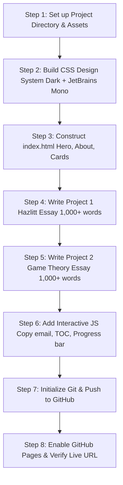

# Portfolio Website Blueprint for Siwat Teimtad (Economist)

A structured, step-by-step plan for building and deploying a high-performance, dark-themed portfolio on GitHub Pages.

---

## 1. Specifications & Design Architecture

### Aesthetics & Typography
- **Theme**: Deep dark palette (`#090a0f`, `#12151f`, `#1e2333` with subtle accents like emerald `#10b981` or cyan `#38bdf8` for data/economic charts).
- **Typography**: [JetBrains Mono](https://fonts.google.com/specimen/JetBrains+Mono) loaded from Google Fonts for a clean, analytical, data-centric aesthetic.
- **Branding**: Navigation bar featuring `black.png` as the site logo, alongside the title *Siwat Teimtad | Economist*.

### Information Architecture
```
my_web/
├── plan/
│   └── our_plan.md                      # This project plan file
├── index.html                           # Landing page (Hero, About, Project Showcase, Contact)
├── black.png                            # Logo asset
├── css/
│   └── style.css                        # Modern dark theme & JetBrains Mono styles
├── js/
│   └── main.js                          # Interactive features (smooth scroll, copy email, reading progress)
├── projects/
│   ├── hazlitt-economics-in-one-lesson.html  # Comprehensive 1,000+ word analysis
│   └── game-theory.html                 # Comprehensive 1,000+ word foundational treatise
└── .nojekyll                            # Ensures static assets bypass Jekyll parsing
```

> [!NOTE]
> Having dedicated pages for the two essays (`projects/*.html`) ensures the long-form analysis (1,000+ words each) has a clean, distraction-free reading layout with typography optimized for long-form economic study, while keeping `index.html` snappy and executive-ready.

---

## 2. Section Breakdown

### A. Hero Section
- **Core Quote**: *"Master Economics, the Simple Way."*
- **Tagline**: Economic Analysis • Strategic Interaction • Policy Evaluation.
- **CTAs**: Primary button linking to `[Read Analyses]` and secondary to `[Contact Me]`.

### B. About Me & Contact
- **Name**: Siwat Teimtad
- **Focus**: Quantitative & qualitative economic analysis, market mechanism evaluation, and strategic decision frameworks.
- **Contact**: Direct email link (`mailto:dx@outlook.com`) with an interactive "Copy to Clipboard" button.

### C. Featured Projects (1,000+ Words Each)
1. **Project 1: Key Economic Concepts of *Economics in One Lesson* (Henry Hazlitt, 1946)**
   - *The One Lesson*: Tracing long-run consequences across all groups rather than short-run effects for single factions.
   - *The Broken Window Fallacy*: The seen vs. the unseen destruction of purchasing power.
   - *Public Works and Taxation*: The illusion of state job creation financed by diverted private capital.
   - *Price Ceilings, Floors, and Inflation*: Supply distortions, deadweight loss, and currency debasement.
   - *Contemporary Relevance*: Applying Hazlitt’s lens to modern fiscal and monetary policy.
   
2. **Project 2: Game Theory: Foundations of Strategic Interaction in Economic Systems**
   - *Axiomatic Foundations*: Players, information sets, utility functions, and payoff matrices.
   - *Equilibrium Concepts*: Dominant strategies, Nash Equilibrium, and mixed strategies.
   - *Dynamic Games & Information*: Backward induction, subgame perfection, and credible commitments.
   - *Classic Dilemmas*: The Prisoner's Dilemma, Stag Hunt, and coordination problems.
   - *Mechanism Design & Information Economics*: Adverse selection, signaling, screening, and auction design.

---

## 3. Step-by-Step Implementation Roadmap



### Phase 1: Local Development
1. **Initialize Workspace**: Create the folder structure (`css/`, `js/`, `projects/`).
2. **Setup Global Styles**:
   - Embed Google Font `JetBrains Mono`.
   - Setup CSS variables for dark theme tokens, line-height, card hover states, and responsive breakpoints.
3. **Assemble Landing Page (`index.html`)**:
   - Navigation bar with `black.png` fallback.
   - Hero banner featuring the quote: *"Master Economics, the Simple Way."*
   - About section with bio and contact (`dx@outlook.com`).
   - Project cards displaying abstracts, word count, estimated reading time, and direct links to the full essays.
4. **Develop Long-Form Project Pages**:
   - Author full 1,000+ word essays with academic rigor, structured headers, callouts, and mathematical/tabular representations.
   - Include a sticky table of contents and reading progress bar for optimal UX.

### Phase 2: GitHub Repository Setup & Deployment
1. **Git Initialization**:
   ```bash
   git init
   git add .
   git commit -m "Initial commit: Siwat Teimtad Economist Portfolio"
   git branch -M main
   ```
2. **Create Remote Repository**:
   - On GitHub, create a new public repository (e.g., `siwat-economics` or `<username>.github.io`).
3. **Push Code**:
   ```bash
   git remote add origin https://github.com/<your-username>/<repo-name>.git
   git push -u origin main
   ```
4. **Activate GitHub Pages**:
   - Navigate to **Repository Settings** > **Pages**.
   - Source: **Deploy from a branch** (`main` branch, `/ (root)` directory).
   - Save and test the live domain: `https://<your-username>.github.io/<repo-name>/`.

---

## 4. Key Questions & Verifications

- **Logo**: Do you already have `black.png` ready to place into `my_web`, or would you like an SVG/CSS fallback rendered until you copy the image over?
- **Domain**: Will you deploy as a project site (e.g., `github.com/user/portfolio`) or as your primary user site (`<username>.github.io`)?
